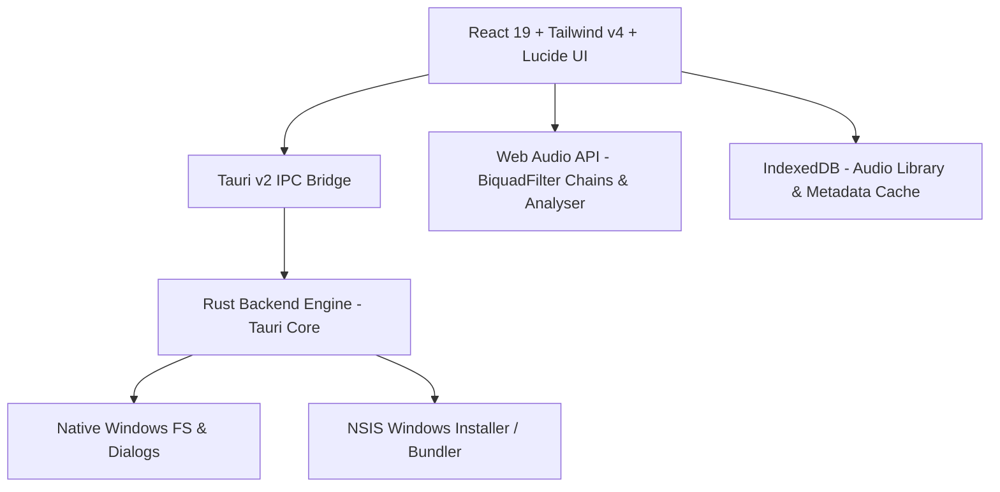

# Aurelia Audio

<div align="center">


**An ultra-modern, high-fidelity desktop audiophile music player.**  
Engineered with **Tauri v2**, **Rust**, **React 19**, and **Tailwind CSS v4**.

[](https://tauri.app)
[](https://www.rust-lang.org)
[](https://react.dev)
[](https://tailwindcss.com)
[](#)
[](#)

</div>

---

## 🌟 Highlights & Key Features

### 🎵 1. Audiophile Playback Engine
- **Broad Format Support**: Lossless FLAC, ALAC, WAV, AIFF, DSD/DSF, MP3, AAC, OGG, and Opus.
- **Continuous Gapless Playback**: Dual alternating audio decks with pre-caching and latency-calibrated deck handoff for zero-gap transitions between tracks.
- **Audio Stream Inspection**: Real-time display of sample rate (44.1 kHz up to 384 kHz), bit depth (16-bit, 24-bit, 32-bit float), bitrate, channel count, and codec container.

### 🎛️ 2. 10-Band Parametric Equalizer (PEQ)
- **High-Precision Tuning**: 10 parametric filter bands with individual Frequency (Hz), Gain (dB), and Q-factor controls.
- **Micro-Stepping**: Gain and Preamp adjustments step by **±0.1 dB** per click (or **±0.5 dB** with <kbd>Shift</kbd> + click) for surgical frequency shaping.
- **Digital Preamp & Anti-Clipping**: Independent pre-amplification stage to prevent inter-sample distortion when boosting frequency peaks.
- **Interactive Frequency Response Curve**: Real-time SVG filter visualization with draggable interactive band nodes.
- **APO / Peace EQ Import**: Direct copy-paste import support for Equalizer APO and Peace EQ configuration files.
- **Presets System**: Built-in curves (Flat/Linear, Warmth, Vocal, Air/Bright, Harman Curve, Diffuse Field) plus unlimited custom user presets with export/import.

### 📊 3. Audio Signals & Acoustic Telemetry
- **PCM Technical Measurements**:
  - Sample Peak (dBFS)
  - True RMS Loudness (dBFS)
  - Crest Factor (Dynamic range quantification in dB)
  - Stereo Phase Correlation metric
  - Digital clipping sample detector
- **Spectral Energy Distribution**: Low / Mid / High energy percentage balance calculator.
- **Offline & Real-Time Waveforms**: High-resolution PCM envelope rendering.

### 📚 4. Smart Album-Aware Music Library
- **Intelligent Album Grouping**: Automatically consolidates multi-artist or compilation albums by folder structure and album tags to eliminate fragmented albums.
- **Zero-Config Import**: Fast folder drag-and-drop or folder picker dialog powered by native Tauri file dialogs.
- **Tag & Artwork Extraction**: Embedded ID3v2, Vorbis comment, and album artwork extraction with high-resolution caching in IndexedDB.
- **Playlists & Smart Queue**: Instant Favorites playlist, custom playlist creation, persistent play queue, shuffle, and repeat modes.

### 🎨 5. State-of-the-Art Glassmorphic Interface
- **Dual Studio Themes**:
  - **Dark Mode**: Cyberpunk glassmorphism with ambient colored glows and deep obsidian contrasts.
  - **Light Mode**: High-contrast, clean studio layout with pure `#ffffff` cards on `#eef2f6` canvas, dark charcoal typography, and subtle shadows.
- **Dynamic Accent Colors**: Preset palette picker + automatic color extraction directly from the current album cover.
- **Interactive Title Bar Island**: Animated soundwave visualizer bars and quick hover controls directly embedded into the title bar.
- **Fullscreen Mode with Synced Lyrics**: Immersive full-window listening experience with synchronized word-by-word / line-by-line LRC lyrics scrolling.

---

## 🛠️ Architecture & Tech Stack



| Layer | Technologies |
| :--- | :--- |
| **Frontend Framework** | React 19, JavaScript (ESNext) |
| **Styling & Design System** | Tailwind CSS v4, Vanilla CSS Design System, Glassmorphic CSS |
| **Desktop Shell** | Tauri v2 (`@tauri-apps/api`, `@tauri-apps/cli`) |
| **Backend / Native** | Rust 2024 Edition, `tauri`, `tauri-build`, `windows-sys` |
| **Audio Processing** | Web Audio API (`AudioContext`, `BiquadFilterNode`, `AnalyserNode`), HTML5 Media Elements |
| **Persistence** | IndexedDB (`localforage` / IDB Wrapper), `localStorage` for settings |
| **Build & Tooling** | Vite v8, Oxlint |

---

## ⌨️ Keyboard Shortcuts

| Shortcut | Action |
| :---: | :--- |
| <kbd>Space</kbd> | Play / Pause |
| <kbd>←</kbd> / <kbd>→</kbd> | Seek backward / forward (5 seconds) |
| <kbd>↑</kbd> / <kbd>↓</kbd> | Volume Up / Down (5%) |
| <kbd>N</kbd> / <kbd>Shift</kbd> + <kbd>→</kbd> | Next track |
| <kbd>P</kbd> / <kbd>Shift</kbd> + <kbd>←</kbd> | Previous track |
| <kbd>M</kbd> | Mute / Unmute audio |
| <kbd>S</kbd> | Toggle Shuffle mode |
| <kbd>R</kbd> | Toggle Repeat mode (Off → All → One) |
| <kbd>F</kbd> | Toggle Immersive Fullscreen Mode |
| <kbd>L</kbd> | Focus Library search input |

---

## 🚀 Getting Started

### Prerequisites

1. **Node.js**: `v20.x` or later (LTS recommended)
2. **Rust**: Latest stable Rust toolchain (`rustup install stable`)
3. **C++ Build Tools**: Visual Studio C++ Build Tools or Windows 10/11 SDK

### 1. Clone & Install Dependencies

```bash
git clone https://github.com/tainguynnn/aureliaplayer.git
cd aureliaplayer

# Install frontend dependencies
npm install
```

### 2. Run in Development Mode

```bash
# Launch Vite dev server with Tauri desktop window
npm run tauri dev
```

*Or to preview only the web interface in your browser:*

```bash
npm run dev
```

### 3. Build Production Installer

To produce a self-contained release executable and NSIS installer:

```bash
npm run tauri build
```

The output installer will be generated at:
```
src-tauri/target/release/bundle/nsis/Aurelia Audio_<version>_x64-setup.exe
```

---

## 📁 Project Structure

```text
aureliaplayer/
├── src/
│   ├── components/
│   │   ├── PeqPanel.jsx          # 10-Band Parametric EQ & curve visualizer
│   │   └── ...
│   ├── App.jsx                   # Master player UI & state container
│   ├── index.css                 # Master Tailwind v4 & Glassmorphic CSS tokens
│   └── main.jsx                  # React application entry point
├── src-tauri/
│   ├── src/
│   │   ├── main.rs               # Rust application entry
│   │   └── lib.rs                # Tauri backend commands & window controls
│   ├── Cargo.toml                # Rust dependencies & metadata
│   ├── tauri.conf.json           # Tauri v2 bundle configuration
│   └── icons/                    # Desktop application icons
├── package.json                  # NPM dependencies & scripts
└── vite.config.js                # Vite build configuration
```

---

## 🤖 AI Disclaimer

This project is developed with the assistance of AI.

---

## 📄 License

This project is licensed under the [MIT License](LICENSE).

